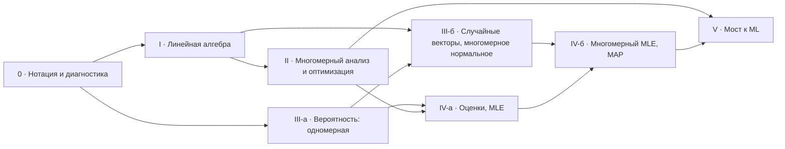
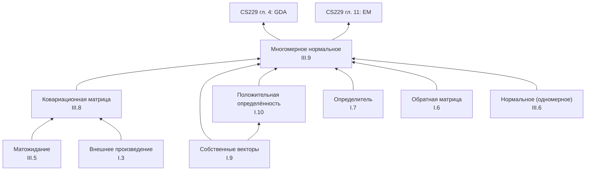

# ML Foundations: анализ курса, дизайн-системы и архитектуры

> Статус: **черновик v0.1 на ревью** · 14.10.2026
> Цель документа: зафиксировать решения до первой строки кода. Всё, что помечено **[решить]**, ждёт вашего ответа (сводка в §12).

---

## 0. Ключевые решения на одной странице

| Область | Решение | Почему |
|---|---|---|
| Что строим | Интерактивный курс-«учебник»: сначала **линейная алгебра (рефрешер)** и **вероятность/статистика**, затем мост к ML по программе Stanford CS229 | CS229 прямо требует ЛА, многомерный анализ и вероятность на уровне MATH51/CS109 |
| Порядок | Нотация → ЛА → многомерный анализ (короткий мост) → вероятность → статистика → мост к ML. Часть вероятности можно проходить параллельно с ЛА | Многомерная вероятность (ковариация, многомерное нормальное) опирается на собственные векторы и квадратичные формы |
| Ключевая фича | Каждая формула знает, **на что опирается** (граф понятий) и **как выводится** (пошаговый вывод, где у каждого шага есть обоснование-ссылка) | Прямое требование; отличает курс от конспекта |
| Визуальный язык | «Научная книга», а не SaaS: тёплая бумага, чернила, засечки для чтения, поля для заметок (как у Тафти), один акцент «прусская синь» | Дефолты shadcn и Tailwind и есть «вайбкодерский» вид, их убираем на уровне токенов |
| Фреймворк | **Astro** (статический сайт, коллекции контента со схемами zod) + **React-острова** для интерактива | Контент статичен, интерактив точечный; типизированный контент держит структуру при росте |
| Компоненты | **Radix UI** через shadcn/ui (код копируется в репозиторий) с **полностью своей темой** | Готовая доступность и клавиатура; внешний вид полностью наш |
| Стили | Tailwind CSS v4, `@theme` с отключённой дефолтной палитрой (`--color-*: initial`) | Нельзя случайно написать `bg-indigo-500`; дизайн-система встроена в инструмент |
| Математика | KaTeX при сборке (без JS на клиенте) + `\htmlData` для «живых» символов | Быстро, SSR, символы можно подсвечивать и объяснять при наведении |
| Визуализации | Mafs (координатная плоскость, векторы, перетаскивание) **за собственным адаптером** + d3-модули и SVG для статистических графиков | Mafs идеален для ЛА, но его активность снизилась, поэтому прячем за интерфейсом |
| Шрифты | Literata (чтение) · IBM Plex Sans (интерфейс) · IBM Plex Mono (код, числа) | Все с кириллицей, без «дефолтного» Inter |

---

## 1. Контекст и цели

**Аудитория.** Человек, который хочет пройти CS229 (или аналогичный курс ML), но математика «забылась» или изучалась без связи с ML. Предполагаю русскоязычную аудиторию **[решить: нужен ли EN]**.

**Что считаем успехом.** После курса ученик может без внешних справочников:

- вывести нормальные уравнения и объяснить их геометрически (проекция);
- посчитать $\nabla_x\, x^\top A x$ и проверить ответ по размерностям;
- объяснить, почему ковариационная матрица положительно полуопределена, и нарисовать линии уровня многомерного нормального распределения по $\Sigma$;
- вывести оценку максимального правдоподобия (MLE) для Бернулли и гауссианы, связать MAP с L2-регуляризацией;
- читать главы 1–4 конспекта CS229, не спотыкаясь на математике.

**Не-цели (пока).** Сам курс ML, аккаунты пользователей, оплата, мобильное приложение.

---

## 2. Дизайн-система

### 2.1 Концепция: «научная книга, которую можно потрогать»

Учебный сайт по математике в первую очередь **читают**, а не кликают. Поэтому основная единица интерфейса — хорошо набранный текст с формулами, а интерактив встраивается в текст как иллюстрация, а не как дашборд.

Визуальные референсы (не шаблоны, а уровень качества):

| Референс | Что берём |
|---|---|
| [Distill.pub](https://distill.pub) | Сетка статьи, интерактивные рисунки внутри текста, подписи к рисункам |
| [Bartosz Ciechanowski](https://ciechanow.ski) | Сдержанные интерактивные виджеты, управление прямо на рисунке |
| [Seeing Theory](https://seeing-theory.brown.edu) (Brown) | Визуализации вероятности: ЗБЧ, ЦПТ, Байес |
| [Immersive Math](http://immersivemath.com) | Интерактивный учебник ЛА: преобразования, определитель, собственные векторы |
| 3Blue1Brown, «Essence of Linear Algebra» | **Цвет закреплён за объектом**: один и тот же цвет у символа в формуле и на графике |
| [Tufte CSS](https://edwardtufte.github.io/tufte-css/) | Заметки на полях (sidenotes) вместо сносок и всплывашек |
| [Учебник по ML ШАД](https://education.yandex.ru/handbook/ml) | Русская терминология |

### 2.2 Чего не делаем: признаки «вайбкодерского» интерфейса

Это проверяемые правила, а не вкусовщина. Пункты, отмеченные ⚙, проверяются линтером или CI.

1. ⚙ Нет градиентов в интерфейсе (особенно фиолетово-синих), нет glassmorphism и `backdrop-blur`.
2. ⚙ Нет дефолтной палитры Tailwind (`slate`, `zinc`, `indigo`…): она отключена в `@theme`. Нет сырых hex-цветов в компонентах: только токены.
3. Нет эмодзи в интерфейсе и заголовках, нет иконки у каждого пункта списка.
4. Нет «сетки карточек с тенью и `rounded-2xl`» как основной формы подачи. Контент — это текст.
5. Нет hero-блока с гигантским заголовком и кнопкой «Начать». Главная — это оглавление курса и карта понятий.
6. Нет маркетингового тона («Раскройте силу…»). Тон — учебник: спокойный, точный.
7. Нет анимаций «ради анимации» (fade-in при прокрутке). Движение только там, где оно объясняет математику (интерполяция преобразования).
8. Нет центрирования всего подряд: выравнивание по левому краю, сетка.
9. Нет декоративных иллюстраций (3D-капли, стоковые фото). Все изображения функциональны.
10. ⚙ Типографика по правилам русского языка: «ёлочки», длинное тире, неразрывные пробелы после предлогов (Typograf на этапе сборки).

### 2.3 Типографика

| Роль | Шрифт | Где |
|---|---|---|
| Чтение | **Literata** (вариативный, оптические размеры, кириллица и греческий) | Текст уроков, заголовки уроков |
| Интерфейс | **IBM Plex Sans** | Навигация, кнопки, подписи виджетов, метки блоков |
| Моноширинный | **IBM Plex Mono** | Код, числовые значения в виджетах (`tabular-nums`) |
| Формулы | KaTeX (шрифты в духе Computer Modern) | Вся математика |

Шрифты подключаются локально через Fontsource, без Google Fonts CDN.

Шкала (база 18 px для текста с засечками, интерфейс 15 px):

| Токен | px | Применение |
|---|---|---|
| `text-xs` | 13 | Подписи осей, метки |
| `text-sm` | 15 | Интерфейс |
| `text-base` | 18 / 1.6 | Основной текст урока |
| `text-lg` | 21 | Лид урока |
| `text-xl` | 25 | H3 |
| `text-2xl` | 30 | H2 |
| `text-3xl` | 38 | H1 урока |

Ширина строки текста — 66–72 знака. Метки блоков («ОПРЕДЕЛЕНИЕ 3.2», «ВЫВОД») набираются капителью в Plex Sans.

### 2.4 Цвет

Все токены заданы в OKLCH (предсказуемая светлота) и переведены в hex. Контраст считался по WCAG; цифры в таблице — отношение к фону `--paper`.

#### Интерфейс

| Токен | Назначение | Светлая | Тёмная |
|---|---|---|---|
| `--paper` | Фон страницы (тёплая бумага) | `#fcfaf6` | `#11151a` |
| `--paper-sunk` | Боковая панель, код | `#f5f2ec` | `#0b0f14` |
| `--surface` | Поле виджета | `#fffefc` | `#1a1e24` |
| `--ink` | Основной текст | `#181d24` · 16.2:1 | `#eae7e2` · 14.9:1 |
| `--ink-2` | Вторичный текст | `#484e55` · 8.1:1 | `#c1bdb7` · 9.8:1 |
| `--ink-3` | Подписи, оси | `#676c73` · 5.1:1 | `#98958e` · 6.1:1 |
| `--rule` | Линейки-разделители | `#dfdcd6` | `#2f3339` |
| `--control-border` | Рамки полей и слайдеров (≥ 3:1) | `#89867f` · 3.5:1 | `#6d7279` · 3.8:1 |
| `--accent` | Ссылки, фокус, активные контролы («прусская синь») | `#115a8b` · 7.1:1 | `#73baea` · 8.7:1 |
| `--accent-hover` | | `#004673` | `#9bd2fa` |
| `--accent-wash` | Фон активного пункта меню | `#e4f2fe` | `#152839` |
| `--marker` | «Маркер» под ключевой мыслью | `#f7e8af` | `#493b13` |

Тёмная тема — «грифельная доска», а не чистый чёрный; её значения подобраны отдельно, а не получены инверсией.

#### Педагогические блоки

Блоки не заливаются цветом. Цвет несут только метка капителью и тонкая (2 px) линейка слева.

| Блок | Светлая | Тёмная |
|---|---|---|
| Определение | `#115a8b` | `#73baea` |
| Теорема / ключевой результат | `#115e5e` | `#70c1c1` |
| Интуиция | `#9c640d` · 4.75:1 | `#e7b369` |
| Типичная ошибка | `#ac3225` | `#eb8373` |
| Упражнение | `#296a3b` | `#7cc58c` |
| Вывод | `--ink-2` | `--ink-2` |

#### Палитра символов: цвет закреплён за ролью

Главный педагогический приём визуала: у математического объекта **один цвет во всём уроке**. Например, $X$ (данные) синий и в формуле, и на графике, а $\theta$ (параметры) киноварный. У каждого слота два значения: «метка» (для линий и точек на графике) и «текст» (для символа в формуле, контраст ≥ 4.5:1).

| Слот | Типичная роль | Метка (светл.) | Метка (тёмн.) | Текст (светл.) | Текст (тёмн.) |
|---|---|---|---|---|---|
| `sym-1` синий | данные, $x$, $X$ | `#0871c1` | `#3f90dd` | `#0062ac` | `#7abdff` |
| `sym-2` киноварь | параметры, $\theta$, $w$ | `#dc5426` | `#e6653c` | `#a73301` | `#ff9776` |
| `sym-3` зелёный | цель, $y$ | `#179765` | `#35aa76` | `#007448` | `#7acca1` |
| `sym-4` охра | ошибка, шум, $\varepsilon$ | `#d79700` | `#c48800` | `#855500` | `#dbaf69` |
| `sym-5` маджента | среднее, $\mu$ | `#c33887` | `#d45198` | `#a1286e` | `#fb8fc4` |
| `sym-6` фиолетовый | ковариация, $\Sigma$ | `#6c4ab3` | `#886acf` | `#6849ab` | `#bda6ff` |

**Проверено валидатором палитр** (симуляция дальтонизма по Machado 2009; ΔE в OKLab ×100):

- соседние слоты: светлая тема — худшая пара для дальтоников ΔE 8.8, для обычного зрения 17.8; тёмная — 8.1 и 15.7; все проверки пройдены;
- **любые три первых слота различимы попарно в обеих темах**; при четырёх слотах в тёмной теме охра и киноварь сливаются;
- охра на светлом фоне даёт 2.5:1, поэтому на графике рядом с ней обязательна подпись.

Отсюда правило: **не больше трёх цветных ролей одновременно в одной формуле или виджете**, остальные символы — цветом `--ink`. Это совпадает с педагогическим принципом «подсвечивай только то, о чём сейчас речь». Цвет никогда не единственный носитель смысла: у символа есть подпись или пояснение при наведении.

Для тепловых карт (плотности, матрицы корреляций) используется последовательная шкала одного оттенка (`sym-1`) и расходящаяся шкала «синий ↔ киноварь» с серой серединой. Обе генерируются из токенов и проверяются тем же валидатором.

### 2.5 Сетка, отступы, формы

- **Раскладка урока** (≥ 1200 px): `[оглавление 260] [текст 680] [поля 280]`. На полях живут заметки, пояснения символов, английские термины, ссылки «опирается на». Меньше 1200 px — заметки встраиваются в текст раскрывающимися блоками; меньше 900 px — оглавление уходит в выдвижную панель.
- **Отступы**: шаг 4 px, шкала `4 8 12 16 24 32 48 64 96`.
- **Скругления**: 2 px у контролов, 4 px у контейнеров. Никаких «пилюль».
- **Тени**: нет. Разделение — линейками и фоном `--paper-sunk`. Исключение — всплывающие слои (popover, tooltip): им нужна тень, чтобы отделиться от текста.
- **Фокус**: обводка 2 px цветом `--accent` с отступом 2 px, видна всегда при навигации с клавиатуры.
- **Движение**: интерфейс 120–200 мс `ease-out`; анимация математики (интерполяция матрицы, рост гистограммы) 400–800 мс. При `prefers-reduced-motion` — мгновенно.
- **Иконки**: Phosphor (regular), только функциональные (навигация, копировать, сброс, воспроизвести). Не у заголовков.

### 2.6 Компоненты

**Примитивы** (Radix через shadcn/ui, перекрашены под токены): Button, Link, Tooltip, Popover, HoverCard, Dialog, Tabs, Collapsible, Accordion, Slider, ToggleGroup, RadioGroup, Checkbox, Progress, Command (поиск, cmdk).

**Педагогические компоненты** (наши, используются в MDX):

| Компонент | Что делает |
|---|---|
| `<Definition>`, `<Theorem>`, `<Intuition>`, `<Pitfall>` | Типизированные блоки с нумерацией и якорем |
| `<Formula ref="…">` | Формула из реестра: символы с пояснениями, «опирается на», вывод, размерности (см. §7) |
| `<Derivation>` | Пошаговый вывод с обоснованием каждого шага |
| `<Prereqs>` | Строка «опирается на» с отметками усвоения |
| `<Sidenote>`, `<Term ru en>` | Заметка на полях; термин с английским эквивалентом (ученик будет читать CS229 по-английски) |
| `<Figure>` | Обёртка виджета: номер, подпись, кнопка сброса, текстовая альтернатива |
| `<Exercise>`, `<Checkpoint>` | Упражнения и короткая самопроверка внутри урока |
| `<CS229 ch="1.2">` | Ссылка «где это встретится в CS229» |

Витрина всех компонентов и виджетов живёт на внутренней странице `/lab`: по ней же идут визуальные регрессионные тесты.

### 2.7 Доступность

WCAG 2.2 AA: контраст (посчитан выше), полная клавиатурная навигация, у виджетов управление с клавиатуры (стрелки двигают точку) и `aria-live` со словесным описанием состояния («Вектор v = (2, 1), длина 2.24»). KaTeX выдаёт MathML для скринридеров. Проверка axe-core в CI.

---

## 3. Библиотеки и стек

| Слой | Выбор | Комментарий |
|---|---|---|
| Фреймворк | **Astro** + MDX | Статическая сборка; коллекции контента со схемами zod; React только там, где интерактив |
| UI-острова | React 19 + TypeScript (strict) | Экосистема Radix, Mafs, d3 |
| Стили | Tailwind CSS v4 + CSS-переменные | Токены в `@theme`, дефолтная палитра отключена |
| Примитивы | Radix UI (через shadcn/ui CLI) | Код в репозитории, внешний вид наш |
| Формулы | KaTeX: `remark-math` + `rehype-katex` при сборке | Макросы курса в одном файле; `trust` разрешён только для `\htmlData` и `\htmlClass` |
| Плоскость, векторы | Mafs | За адаптером `widgets/_kit/Plane` |
| Статистические графики | d3-scale, d3-shape, d3-array + SVG в React | Гистограммы, плотности, линии уровня |
| Численные расчёты | Свой модуль `lib/math` (TS) + детерминированный ГПСЧ с seed | Прозрачно для учеников; покрыт тестами против NumPy |
| Граф понятий | elkjs (раскладка DAG) + SVG | Страница «карта курса» |
| Состояние | nanostores + localStorage (версионированная схема) | Общий стор для островов Astro; позже — адаптер синхронизации |
| Поиск | Pagefind | Статический поиск по собранному сайту |
| Русская типографика | Typograf в remark-плагине | Кавычки, тире, неразрывные пробелы |
| Символьные ответы (этап 3) | MathLive + Compute Engine | Ввод формулы и проверка эквивалентности |
| Код в браузере (этап 4) | Pyodide в Web Worker, ленивая загрузка | NumPy прямо в уроке, как требует CS229 |
| Тесты | Vitest, Playwright (+ скриншоты), axe-core | См. §9 |
| Хостинг | GitHub Pages или Cloudflare Pages **[решить]** | Статика, бэкенд не нужен |

**Почему не Next.js + Fumadocs.** Хороший вариант, если скоро нужны аккаунты и серверная логика. Для статичного курса Astro проще, быстрее и строже в контенте; при необходимости в Astro добавляются серверные эндпоинты.
**Почему не Starlight или Docusaurus.** У них узнаваемый вид документации, а курсу нужны свои раскладка (поля, карта понятий, выводы), и с темой пришлось бы бороться.
**Почему не MathJax.** У MathJax 4 сильнее озвучка, но KaTeX при сборке не грузит JS на клиент и рендерит быстрее. MathML от KaTeX покрывает базовую доступность.

---

## 4. Скиллы и плагины для работы

**Уже доступны в этой сессии:**

| Скилл | Зачем |
|---|---|
| `dataviz` | Правила графиков и валидатор палитр (палитра символов из §2.4 проверена им) |
| `run` | Запуск сайта и скриншоты для проверки виджетов |
| `code-review`, `simplify`, `security-review` | Ревью перед коммитами |
| `session-start-hook` | Настроить облачные сессии: установка зависимостей, тесты при старте |

**Рекомендую установить** (каталог Anthropic Directory):

| Плагин | Автор | Зачем |
|---|---|---|
| **frontend-design** | Anthropic | Руководство по UI без «генерического AI-вида»: ровно наша задача |
| **Design** | Anthropic | Скиллы `design-system`, `design-critique`, `accessibility-review`, `ux-copy` (MCP-серверы плагина — Figma, Slack и т. п. — не нужны) |
| A11y Enforcer | сообщество | Проверки WCAG 2.2 для React и Astro (необязательно, если хватит axe в CI) |

**Свои скиллы проекта** (`.claude/skills/`, создаём через `skill-creator` на этапе 1). Они делают расширение курса механическим:

- `new-lesson` — каркас урока по шаблону (§6) с frontmatter по схеме;
- `new-widget` — каркас виджета: `model.ts` + представление + тест + README;
- `derivation-check` — численная проверка шагов вывода и тождеств (§9);
- `content-review` — чек-лист педагогики и типографики для нового урока.

---

## 5. Программа курса

### 5.1 Опора: Stanford CS229 (Andrew Ng)

**Что CS229 ожидает от студента** (официальные пререквизиты):

- Python и NumPy на уровне CS106A/B;
- теория вероятностей на уровне **CS109** или MATH151;
- многомерный анализ и линейная алгебра на уровне **MATH51** или CS205L.

**Официальные справочные материалы CS229, которые мы покрываем и расширяем:**

- *Linear Algebra Review and Reference* — Z. Kolter, обновления C. Do, T. Ma. Структура: нотация → умножение матриц (вектор-вектор, матрица-вектор, матрица-матрица) → свойства (единичная и диагональная матрицы, транспонирование, симметричность, след, нормы, линейная независимость и ранг, обратная, ортогональные матрицы, пространство столбцов и ядро, определитель, квадратичные формы и PSD, собственные значения) → матричное дифференцирование.
- *Probability Theory Review and Reference* — A. Maleki, T. Do, обновления H. Yuan, T. Ma. Структура: вероятностное пространство, условная вероятность, Байес → случайные величины, CDF/PMF/PDF, матожидание, дисперсия → несколько величин → ЗБЧ и ЦПТ → многомерное нормальное распределение.
- Конспект лекций CS229 (*main notes*, T. Ma, A. Ng): из математики там нужны нормальные уравнения, вероятностная интерпретация МНК, экспоненциальное семейство (GLM), GDA, ядра, двойственность (SVM), bias-variance, EM (неравенство Йенсена), PCA.
- Шпаргалки A. и S. Amidi к CS229: «Probabilities and Statistics refresher», «Linear Algebra and Calculus refresher».

Из Coursera Machine Learning Specialization (A. Ng, DeepLearning.AI) берём **педагогический порядок**: сначала интуиция и картинка, потом код, потом строгая математика. Порядок закреплён в шаблоне урока (§6).

> Материалы Stanford используем как ориентир программы, а не как источник текста или иллюстраций: весь контент пишем сами, на оригиналы ставим ссылки.

### 5.2 Входные знания (до нашего курса)

| Уровень | Что | Как проверяем |
|---|---|---|
| **Обязательно** | Школьная алгебра: степени, логарифмы, функции и графики; производные элементарных функций и правило цепочки (10–11 класс) | Входная диагностика |
| Желательно | Базовый Python (переменные, циклы, функции) | Нужен только с этапа кода (Pyodide) |
| Не требуется | Вузовские ЛА, матанализ, теорвер | Это и есть содержание курса |

**Модуль 0 + диагностика.** Около 20 вопросов по нотации, алгебре, производным, основам ЛА и вероятности. По результату курс предлагает маршрут: начать с модуля 0, сразу перейти к ЛА или пропустить отдельные уроки (они отмечаются как «подтверждено тестом»).

### 5.3 Карта модулей



Рекомендуемый линейный порядок: **0 → I → II → III → IV → V**. Модуль III-а не зависит от ЛА, его можно проходить параллельно.

> **[решить]** Вы просили «сначала статистику, потом рефрешер ЛА». Предлагаю обратный порядок: многомерная часть вероятности опирается на собственные векторы и положительную определённость. Компромисс: одномерную вероятность (III-а) можно поставить первой — она от ЛА не зависит.

> **[решить]** Модуль II (многомерный анализ) вы не упоминали, но без градиента, гессиана и выпуклости не вывести ни нормальные уравнения, ни MLE в матричной форме, а CS229 требует MATH51. Предлагаю короткий мост на 8–10 часов.

Оценка объёма: **≈ 65–85 часов** обучения (модуль 0: 3–5 ч, I: 20–25 ч, II: 8–10 ч, III: 15–20 ч, IV: 12–15 ч, V: 6–8 ч).

### 5.4 Модуль 0. Нотация и инструменты

| # | Урок | Ключевое |
|---|---|---|
| 0.1 | Как устроен курс | Карта, слои урока, выводы, прогресс |
| 0.2 | Входная диагностика | Персональный маршрут |
| 0.3 | Язык математики | Множества, $\in$, $\subset$, кванторы, $\mathbb{R}^n$, функции $f:\mathbb{R}^n\to\mathbb{R}$ |
| 0.4 | Суммы и произведения | $\sum$, $\prod$, индексы, перестановка сумм; это «скрытая» матричная запись |
| 0.5 | Экспонента и логарифм | $\log\prod = \sum\log$ — фундамент log-likelihood |
| 0.6 | Производная (повторение) | Правила дифференцирования, правило цепочки |

### 5.5 Часть I. Линейная алгебра (рефрешер)

Структура следует *Linear Algebra Review* CS229, геометрия — в духе 3Blue1Brown и Immersive Math.

| # | Урок | Ключевые формулы и понятия | Интерактив | Где в CS229 |
|---|---|---|---|---|
| I.1 | Векторы, линейные комбинации, оболочка | span, линейная независимость, базис, размерность | Перетаскиваем два вектора: их span — прямая или плоскость | Везде: признаки как векторы |
| I.2 | Скалярное произведение и нормы | $x^\top y = \lVert x\rVert\lVert y\rVert\cos\varphi$; нормы $\ell_1,\ell_2,\ell_\infty$; проекция на вектор | Единичные «шары» норм; проекция с подвижным углом | Регуляризация L1/L2, ядра |
| I.3 | Умножение матриц: четыре взгляда | Скалярные произведения строк и столбцов, сумма внешних произведений, комбинации столбцов, комбинации строк | Переключатель «взгляда» на одно и то же произведение; проверка размерностей | Векторизация в гл. 1–2 |
| I.4 | Матрица как линейное отображение | Композиция = произведение; единичная и диагональная матрицы | Сетка плоскости деформируется под матрицу 2×2 | Нейросети как композиции |
| I.5 | Транспонирование, симметрия, след | $(AB)^\top=B^\top A^\top$; $\operatorname{tr}(AB)=\operatorname{tr}(BA)$ | Тренажёр тождеств | Матричное дифференцирование |
| I.6 | Ранг, обратная, системы | Ранг, $(AB)^{-1}=B^{-1}A^{-1}$, пространство столбцов, ядро, теорема о ранге | Решение $Ax=b$: когда решений нет, одно или бесконечно много | Обратимость $X^\top X$ |
| I.7 | Определитель | Определитель как коэффициент изменения площади; знак — ориентация; $\det A=0 \iff$ матрица вырождена | Квадрат превращается в параллелограмм, площадь подписана | Плотность многомерного нормального, ICA |
| I.8 | Ортогональность и проекции | Ортогональные матрицы, проекция на подпространство, МНК как проекция; ★ Грам — Шмидт | Проекция $b$ на пространство столбцов | Гл. 1: геометрия МНК |
| I.9 | Собственные значения и векторы | $Av=\lambda v$, диагонализация, спектральная теорема для симметричных матриц | Тянем вектор $v$, видим $Av$; совпали направления — собственный вектор | PCA, ковариация |
| I.10 | Квадратичные формы и положительная определённость | $x^\top A x$; PSD/PD; эллипсы линий уровня, оси — собственные векторы | Линии уровня $x^\top A x$ при изменении $A$ | Гессиан, ковариация, ядра |
| I.11 | ★ Сингулярное разложение | $A=U\Sigma V^\top$: поворот, растяжение, поворот; малоранговое приближение | Единичная окружность → эллипс по шагам | PCA (гл. 12) |
| I.12 | Матричное дифференцирование | $\nabla_x b^\top x=b$; $\nabla_x x^\top Ax=(A+A^\top)x$; $\nabla_A\operatorname{tr}(AB)=B^\top$; ★ $\nabla_A\log\det A=A^{-\top}$ | Проверка размерностей; сравнение с численным градиентом | **Нормальные уравнения (гл. 1)**, MLE для гауссианы |

★ — углубление: свёрнуто по умолчанию, не блокирует прогресс.

### 5.6 Часть II. Многомерный анализ и оптимизация (мост)

| # | Урок | Ключевое | Интерактив | Где в CS229 |
|---|---|---|---|---|
| II.1 | Частные производные и градиент | Градиент — направление наискорейшего роста, перпендикулярен линиям уровня | Поле градиентов поверх линий уровня | Градиентный спуск (гл. 1) |
| II.2 | Многомерное правило цепочки | Якобиан, композиция отображений | Пошаговое прохождение вычислительного графа | Обратное распространение (гл. 7) |
| II.3 | Гессиан и ряд Тейлора | Квадратичное приближение | Парабола-аппроксимация в точке | Метод Ньютона (гл. 2) |
| II.4 | Выпуклость | Выпуклые функции; PSD-гессиан ⇒ выпуклость; локальный минимум выпуклой функции глобален | Хорда над графиком | Почему логистическая регрессия «хорошая» |
| II.5 | Градиентный спуск | Шаг обучения, сходимость, обусловленность | Спуск по квадратичной чаше: слишком большой шаг расходится | Гл. 1–2, 7 |
| II.6 | ★ Условная оптимизация | Множители Лагранжа, идея двойственности | Касание линии уровня и ограничения | SVM (гл. 6) |

### 5.7 Часть III. Теория вероятностей

Структура следует *Probability Theory Review* CS229 и курсу CS109.

| # | Урок | Ключевое | Интерактив | Где в CS229 |
|---|---|---|---|---|
| III.1 | Вероятностное пространство | Исходы, события, аксиомы; ★ комбинаторика | События как области | — |
| III.2 | Условная вероятность и независимость | $P(A\mid B)$, правило цепочки, условная независимость | Условие «сужает мир» | Naive Bayes (гл. 4) |
| III.3 | Формула полной вероятности и Байес | $P(A\mid B)=\dfrac{P(B\mid A)P(A)}{P(B)}$ | Медицинский тест: частоты на сетке из 1000 человек | Генеративные модели (гл. 4) |
| III.4 | Случайные величины | Дискретные и непрерывные; PMF, PDF, CDF | Связь PDF и CDF при перетаскивании порога | — |
| III.5 | Матожидание и дисперсия | Линейность, LOTUS, $\operatorname{Var}X=\mathbb{E}X^2-(\mathbb{E}X)^2$; неравенство Йенсена | Матожидание как «центр масс» | EM (гл. 11) |
| III.6 | Каталог распределений | Бернулли, биномиальное, геометрическое, Пуассона, категориальное; равномерное, экспоненциальное, нормальное; связи между ними | Обозреватель распределений с параметрами | Гл. 2–4 |
| III.7 | Совместные распределения | Совместное, маргинальное, условное; ковариация, корреляция; закон полного матожидания | Облако точек: перетаскиваем, видим корреляцию | — |
| III.8 | Случайные векторы | $\mu=\mathbb{E}X$, $\Sigma=\mathbb{E}(X-\mu)(X-\mu)^\top$, $\Sigma\succeq 0$; $\operatorname{Cov}(AX)=A\Sigma A^\top$ | Линейное преобразование облака точек | GDA, факторный анализ |
| III.9 | Многомерное нормальное распределение | Плотность; линии уровня — эллипсы по собственным векторам $\Sigma$; ★ условные и маргинальные распределения гауссовы | Редактор $\mu$ и $\Sigma$: эллипсы и выборка | **GDA (гл. 4)**, EM |
| III.10 | Предельные теоремы | Закон больших чисел, центральная предельная теорема | Бегущее среднее; гистограмма суммы $n$ величин | Обоснование MLE и доверительных интервалов |
| III.11 | ★ Информация | Энтропия, кросс-энтропия, KL-дивергенция | KL между двумя гауссианами | Логистическая функция потерь, EM, VAE |

### 5.8 Часть IV. Математическая статистика

| # | Урок | Ключевое | Интерактив | Где в CS229 |
|---|---|---|---|---|
| IV.1 | Выборка и описательная статистика | Среднее, медиана, дисперсия, квантили; выборка и генеральная совокупность | Перетаскиваем выброс: среднее уезжает, медиана стоит | — |
| IV.2 | Оценки и их свойства | Смещение, дисперсия, $\text{MSE}=\text{bias}^2+\text{Var}$, состоятельность; почему $n-1$ | Симуляция распределения оценки | **Bias-variance (гл. 8)** |
| IV.3 | Метод максимального правдоподобия | Правдоподобие, log-likelihood, MLE для Бернулли и гауссианы | Двигаем параметр — видим кривую правдоподобия | **Гл. 1–4 целиком** |
| IV.4 | ★ Многомерный MLE | MLE для $\mu$ и $\Sigma$ (трюк со следом, $\nabla\log\det$) | — | GDA (гл. 4) |
| IV.5 | Байесовский подход и MAP | Априорное и апостериорное распределения, сопряжённость Beta-Bernoulli; MAP с гауссовым априорным = L2 | «Сила» априорного распределения против числа подбрасываний | Регуляризация (гл. 9), сглаживание Лапласа |
| IV.6 | Доверительные интервалы | Через ЦПТ; правильная интерпретация; ★ бутстрэп | 100 интервалов: сколько накрыли истинное значение | Оценка качества моделей |
| IV.7 | Проверка гипотез | $H_0$, p-value, ошибки I и II рода, мощность, A/B-тест; ★ множественные сравнения | Распределение p-value при верной $H_0$ | Не нужен для CS229, нужен на практике **[решить: объём]** |

### 5.9 Часть V. Мост к ML (капстоун)

Здесь всё собирается вместе: каждый урок — это одна модель из CS229, выведенная с опорой на предыдущие части.

| # | Урок | Что сходится | CS229 |
|---|---|---|---|
| V.1 | **Линейная регрессия тремя способами** | (а) проекция на пространство столбцов (I.8); (б) нормальные уравнения через градиент (I.12, II.4); (в) MLE при гауссовом шуме = МНК (IV.3). Три вывода дают одну формулу | Гл. 1 |
| V.2 | Логистическая регрессия как MLE | Бернулли + сигмоида → кросс-энтропия; градиент; выпуклость через гессиан | Гл. 2 |
| V.3 | Bias-variance и регуляризация | Разложение MSE (IV.2) → сложность модели; ridge = MAP (IV.5) | Гл. 8–9 |
| V.4 | PCA | Собственные векторы ковариационной матрицы (I.9 + III.8) | Гл. 12 |

### 5.10 Матрица «понятие → где пригодится в CS229»

Эта таблица генерируется из графа понятий автоматически. На странице каждого понятия она видна как «где используется».

| Понятие курса | Где в CS229 (конспект main notes) |
|---|---|
| След, транспонирование, $\nabla_A\operatorname{tr}$ | Гл. 1: вывод нормальных уравнений |
| Проекции, пространство столбцов | Гл. 1: геометрия МНК |
| Нормальное распределение, MLE | Гл. 1: вероятностная интерпретация МНК |
| Бернулли, MLE, гессиан, метод Ньютона | Гл. 2: логистическая регрессия |
| Экспоненциальное семейство | Гл. 3: GLM |
| Многомерное нормальное, Байес, условная независимость | Гл. 4: GDA, Naive Bayes |
| Положительная полуопределённость, матрица Грама | Гл. 5: ядра |
| Лагранжиан, двойственность, выпуклость | Гл. 6: SVM |
| Правило цепочки, якобиан | Гл. 7: обратное распространение |
| MSE = bias² + variance | Гл. 8: обобщение |
| MAP ↔ регуляризация | Гл. 9: регуляризация, выбор модели |
| Неравенство Йенсена, KL, смесь гауссиан | Гл. 11: EM |
| Собственные векторы $\Sigma$, SVD | Гл. 12: PCA |
| Плотность при линейном преобразовании, $\det$ | Гл. 13: ICA |

> Номера глав — по изданию main notes 2023+. Сверить при наполнении: сайт cs229.stanford.edu из этой среды недоступен.

> **[решить]** Экспоненциальное семейство (нужно для гл. 3) предлагаю дать отдельным уроком ★ в части IV или в начале курса ML.

---

## 6. Педагогическая модель: анатомия урока

Каждый урок собирается из одних и тех же слоёв. Шаблон задаётся схемой, его проверяет CI.

1. **Зачем** — 2–3 предложения и конкретное место в ML («в гл. 1 CS229 это даёт формулу весов…»).
2. **Опирается на** — пререквизиты с отметками усвоения. Для каждого можно пройти «быструю проверку» из одного вопроса: не ответил — ссылка на повторение.
3. **Интуиция** — сначала картинка и интерактив, без формул.
4. **Формально** — определения и теоремы.
5. **Вывод** — пошаговые выводы ключевых формул (§7).
6. **В коде** — короткий сниппет NumPy (позже исполняемый, Pyodide).
7. **Типичные ошибки** — то, на чём спотыкаются (например, $(AB)^\top\ne A^\top B^\top$).
8. **Проверь себя** — упражнения.
9. **Итог и дальше** — три-пять пунктов и ссылки вперёд, «где это понадобится».

**Глубина.** Блоки ★ свёрнуты и не блокируют прогресс. Есть переключатель «Только суть / Полная версия».

**Термины.** При первом появлении русский термин сопровождается английским на полях: «собственный вектор (*eigenvector*)». Из этих пометок собирается глоссарий RU ↔ EN.

**Типы упражнений:**

| Тип | Этап | Пример |
|---|---|---|
| Числовой ответ с допуском, параметризованный seed'ом | MVP | «Найдите $\det A$» — новая матрица при каждой попытке |
| Выбор ответа с разбором каждого неверного варианта | MVP | Неверный вариант = типичная ошибка из п. 7 |
| Ввод вектора или матрицы сеткой | MVP | «Вычислите $AB$» |
| Порядок шагов вывода | MVP | Перетащить шаги вывода в правильном порядке |
| «Предскажи, потом проверь» в виджете | MVP | «Подберите $\Sigma$ с отрицательной корреляцией» |
| Символьный ответ | Этап 3 | «Найдите $\nabla_x\, x^\top A x$» (MathLive) |
| Код | Этап 4 | Реализовать нормальные уравнения на NumPy |

**Прогресс** ведётся по понятиям, а не по страницам. Состояния: не начато → прочитано → подтверждено упражнениями. Карта курса раскрашивается по этим состояниям.

---

## 7. Формулы: «на что опираются» и «как выводятся»

Это центральная фича, поэтому формулы — не текст внутри MDX, а **данные**: отдельная коллекция с реестром, схемой и проверками.

### 7.1 Модель данных

Три сущности, связанные в один граф:

- **Понятие** (`concept`): `la.eigenvector`, `prob.bayes`, `stat.mle`… Хранит пререквизиты и ссылки на CS229.
- **Правило** (`rule`): атомарное тождество, на которое ссылаются шаги выводов, например `rule.transpose-product`: $(AB)^\top=B^\top A^\top$. У правила может быть свой вывод, поэтому обоснование можно «раскрывать» вглубь до покоординатной записи.
- **Формула** (`formula`): утверждение + символы + условия применимости + вывод из шагов, каждый со ссылками на правила и понятия.

```ts
// Эскиз типов (реальные схемы — zod в src/content.config.ts)
type ConceptId = `${'nota' | 'la' | 'calc' | 'prob' | 'stat' | 'ml'}.${string}`;
type RuleId = `rule.${string}`;

interface SymbolSpec {
  tex: string;                 // "\\theta"
  meaning: string;             // "вектор параметров"
  shape?: [string, string];    // ["d", "1"] — для проверки размерностей
  role?: 'data' | 'param' | 'target' | 'noise' | 'mean' | 'cov'; // → цвет sym-N
}

interface DerivationStep {
  tex: string;                 // строка вывода; \changed{…} подсвечивает изменившуюся часть
  by: (RuleId | ConceptId)[];  // обоснование: «по какому правилу»
  note?: string;               // короткое пояснение на полях
  why?: string;                // развёрнутое «почему», раскрывается по клику
}

interface Formula {
  id: string;
  title: string;
  statement: string;
  symbols: SymbolSpec[];
  dependsOn: { concepts: ConceptId[]; rules: RuleId[] };
  conditions?: { tex: string; why: string; concept?: ConceptId }[];
  derivation?: DerivationStep[];
  check?: { kind: 'numeric'; fixture: string }; // автоматическая численная проверка
}
```

### 7.2 Пример: нормальные уравнения

```yaml
# content/formulas/la/normal-equations.yaml
id: f.normal-equations
title: Нормальные уравнения
statement: \theta^\star = (X^\top X)^{-1} X^\top y
symbols:
  - { tex: X,      meaning: "матрица признаков, строки — объекты", shape: [n, d], role: data }
  - { tex: \theta, meaning: "вектор параметров",                   shape: [d, 1], role: param }
  - { tex: y,      meaning: "вектор целевых значений",             shape: [n, 1], role: target }
dependsOn:
  concepts: [la.matmul, la.transpose, la.inverse, la.rank, calc.gradient, calc.convexity]
  rules: [rule.transpose-product, rule.scalar-transpose, rule.grad-linear, rule.grad-quadratic]
conditions:
  - tex: \operatorname{rank} X = d
    why: "Иначе X^T X вырождена и обратной не существует"
    concept: la.rank
derivation:
  - tex: J(\theta) = \tfrac12 (X\theta - y)^\top (X\theta - y)
    by: [ml.least-squares]
    note: Функция потерь МНК в матричной форме
  - tex: = \tfrac12\left(\theta^\top X^\top X\theta - \theta^\top X^\top y - y^\top X\theta + y^\top y\right)
    by: [rule.transpose-product]
    note: Раскрываем скобки, (Xθ)ᵀ = θᵀXᵀ
  - tex: = \tfrac12\left(\theta^\top X^\top X\theta - \changed{2\,y^\top X\theta} + y^\top y\right)
    by: [rule.scalar-transpose]
    note: θᵀXᵀy — число (1×1), а число равно своему транспонированию
  - tex: \nabla_\theta J = X^\top X\theta - X^\top y
    by: [rule.grad-quadratic, rule.grad-linear]
    note: XᵀX симметрична, поэтому ∇(θᵀAθ) = 2Aθ
  - tex: X^\top X\theta = X^\top y
    by: [calc.stationary-point, calc.convexity]
    note: Приравниваем градиент к нулю; гессиан XᵀX ⪰ 0, J выпукла — это глобальный минимум
  - tex: \theta^\star = (X^\top X)^{-1} X^\top y
    by: [la.inverse]
    note: Требует rank X = d (см. условия)
check: { kind: numeric, fixture: normal-equations.json }
```

### 7.3 Как это выглядит в уроке

```
┌ ФОРМУЛА 12.4 · Нормальные уравнения ──────────────────────────┐
│                                                                │   ПОЛЯ
│              θ* = (XᵀX)⁻¹ Xᵀ y                                 │   X — матрица признаков
│                                                                │       n × d
│  Опирается на:  ✓ умножение матриц  ✓ транспонирование         │   (наведите на символ)
│                 ○ ранг  ○ градиент  ○ выпуклость               │
│  Условие: rank X = d                                           │
│                                                                │
│  [ Вывод · 6 шагов ]  [ Размерности ]  [ Где используется ]    │
└────────────────────────────────────────────────────────────────┘

  Вывод, шаг 3 из 6                           [ ← ] [ → ] [ Все шаги ]
  = ½ (θᵀXᵀXθ − ▒2yᵀXθ▒ + yᵀy)                    ⟵ по правилу «скаляр
                                                     равен своему транспонированию»
                                                     [почему?]
```

Поведение:

- **Символы живые.** Наведение или фокус на $\theta$ подсвечивает все его вхождения в формуле, выводе и виджете на странице; на полях — смысл и размерность. Символы доступны по Tab.
- **«Опирается на»** — строка понятий с отметками усвоения. Наведение показывает мини-карточку с определением, клик ведёт на урок с кнопкой «← вернуться к выводу».
- **Вывод по шагам.** Изменившаяся часть подсвечена (макрос `\changed{}`), справа — обоснование-ссылка на правило. У правила свой вывод, поэтому можно спуститься до основ.
- **Режим тренировки**: перед показом следующего шага курс спрашивает «какое правило применим?» (сначала вспомни, потом смотри).
- **Размерности**: под каждым множителем подписи вида $\underbrace{X^\top}_{d\times n}\underbrace{X}_{n\times d}\underbrace{\theta}_{d\times 1}$; несогласованные размерности ловятся ещё при сборке.
- **Где используется** — обратные ссылки, вычисляются из графа.

### 7.4 Пример цепочки зависимостей



---

## 8. Архитектура кода

### 8.1 Принципы

1. **Контент ≠ представление ≠ логика.** Авторы правят только `content/`; компоненты не знают о конкретных уроках; математика не знает о DOM.
2. **Всё, на что ссылаются, имеет стабильный ID** (`la.eigenvector`, `rule.transpose-product`, `f.normal-equations`), а сборка проверяет, что каждая ссылка существует.
3. **Виджет = чистая модель + представление.** Модель (`model.ts`) — чистые функции, тестируется без браузера; представление — тонкий React-слой.
4. **Детерминизм.** Все симуляции используют ГПСЧ с seed: картинка в тексте совпадает с тем, что видит ученик, а тесты воспроизводимы.
5. **Сторонние библиотеки визуализации — за адаптерами** (`widgets/_kit`), чтобы замена Mafs не трогала уроки.

### 8.2 Структура репозитория

```
machine-course/
├── docs/
│   ├── analysis.md                 # этот документ
│   ├── adr/                        # записи архитектурных решений (по одной на решение)
│   └── authoring.md                # гайд автора: как написать урок, формулу, упражнение
├── content/                        # ВЕСЬ учебный контент, без кода
│   ├── courses/foundations/
│   │   ├── course.yaml             # порядок модулей, метаданные
│   │   ├── 00-notation/
│   │   │   ├── module.yaml
│   │   │   └── 03-sets-and-sums.mdx
│   │   ├── 01-linear-algebra/ …
│   │   └── 05-bridge-to-ml/ …
│   ├── concepts/                   # граф понятий: по файлу на раздел (la.yaml, prob.yaml…)
│   ├── formulas/
│   │   ├── rules/                  # атомарные тождества
│   │   └── la/ calc/ prob/ stat/   # формулы с выводами
│   ├── exercises/                  # банки упражнений (параметрические — со ссылкой на генератор)
│   └── glossary.yaml               # RU ↔ EN
├── src/
│   ├── content.config.ts           # zod-схемы всех коллекций
│   ├── design-system/
│   │   ├── tokens/                 # tokens.css (светлая и тёмная), theme.css (@theme Tailwind)
│   │   ├── fonts/
│   │   └── primitives/             # Button, Tooltip, Popover, Tabs, Slider… (Radix + токены)
│   ├── components/
│   │   ├── layout/                 # CourseShell, LessonLayout, Toc, Sidenote, ThemeToggle
│   │   └── pedagogy/               # Definition, Theorem, Formula, Derivation, Prereqs, Exercise…
│   ├── widgets/
│   │   ├── _kit/                   # Plane (адаптер Mafs), Histogram, Axis, ParamSlider, Readout
│   │   ├── linear-algebra/
│   │   │   └── matrix-transform/
│   │   │       ├── model.ts        # чистая математика состояния
│   │   │       ├── model.test.ts
│   │   │       ├── MatrixTransform.tsx
│   │   │       ├── index.ts        # публичный API + meta (id, понятия, описание)
│   │   │       └── README.md
│   │   └── probability/ statistics/
│   ├── lib/
│   │   ├── math/                   # linalg, stats, distributions, random (seeded) — без DOM
│   │   ├── content/                # граф: DAG, топологическая сортировка, обратные ссылки
│   │   ├── katex/                  # макросы курса, роли символов → цвета
│   │   ├── exercises/              # проверка ответов, генераторы параметрических задач
│   │   └── progress/               # стор, схема, адаптер хранилища (localStorage → бэкенд позже)
│   ├── pages/
│   │   ├── index.astro             # оглавление курса
│   │   ├── map.astro               # карта понятий
│   │   ├── [course]/[module]/[lesson].astro
│   │   ├── concepts/[id].astro     # карточка понятия + «где используется»
│   │   ├── formulas/[id].astro
│   │   └── lab/                    # витрина дизайн-системы и виджетов
│   └── i18n/ru.ts                  # строки интерфейса
├── scripts/
│   ├── validate-content.ts         # DAG без циклов, все ссылки существуют, KaTeX компилируется
│   └── gen-fixtures.py             # NumPy/SciPy → JSON-фикстуры для тестов математики
├── tests/
│   ├── e2e/                        # Playwright: навигация, прогресс, упражнения
│   └── visual/                     # скриншоты /lab
└── .claude/skills/                 # new-lesson, new-widget, derivation-check, content-review
```

### 8.3 Правила зависимостей между слоями

Проверяются ESLint (`eslint-plugin-boundaries`):

| Слой | Может импортировать |
|---|---|
| `content/*.mdx` | `components/pedagogy`, `widgets/*` (только через `index.ts`) |
| `widgets/*` | `widgets/_kit`, `lib/math`, `design-system/primitives`. **Не** импортирует другие виджеты и контент |
| `components/*` | `design-system`, `lib/*` |
| `lib/math` | ничего из проекта (чистый TS) |
| `design-system` | ничего из проекта |

### 8.4 Контракт виджета

```ts
// widgets/linear-algebra/matrix-transform/index.ts
export const meta = {
  id: 'la.matrix-transform',
  title: 'Матрица как преобразование плоскости',
  concepts: ['la.linear-map', 'la.determinant'],
} as const;

export interface MatrixTransformProps {
  initial?: { matrix: [[number, number], [number, number]] };
  lock?: ('a' | 'b' | 'c' | 'd')[];  // зафиксировать элементы для конкретного урока
  show?: ('grid' | 'basis' | 'det' | 'eigen')[];
  seed?: number;
}
```

Каждый виджет обязан: управляться с клавиатуры, описывать состояние текстом (`aria-live`), иметь кнопку «сброс» и сериализуемое состояние (ссылка «посмотри на эту конфигурацию»). Один виджет переиспользуется в разных уроках с разными `initial`, `lock` и `show`.

---

## 9. Качество и тестирование

| Что | Как |
|---|---|
| Математика в `lib/math` | Vitest против фикстур, посчитанных NumPy/SciPy (`scripts/gen-fixtures.py`) |
| **Тождества и выводы** | Каждое правило проверяется численно на случайных матрицах: например, $\nabla_x x^\top Ax$ сравнивается с конечными разностями. Формулы с `check` прогоняются в CI. Ошибка в выводе — красный билд |
| Контент | `validate-content.ts`: граф понятий без циклов, все ID существуют, все формулы компилируются KaTeX, размерности в `symbols` согласованы, у урока есть все обязательные слои |
| Компоненты и виджеты | Playwright: скриншоты `/lab` в обеих темах (визуальная регрессия) |
| Доступность | axe-core на каждой странице в e2e |
| Дизайн-система | stylelint: запрет градиентов, `box-shadow` вне токенов и сырых цветов |
| Производительность | Бюджет: ≤ 100 KB JS на урок без виджетов; виджеты грузятся при появлении в зоне видимости (`client:visible`) |
| CI | GitHub Actions: lint → typecheck → unit → validate-content → build → e2e → деплой превью |

---

## 10. План работ

| Этап | Результат | Критерий готовности |
|---|---|---|
| **0. Ревью** (сейчас) | Ответы на §12, фиксация решений в `docs/adr/` | Документ согласован |
| **1. Каркас и дизайн-система** | Astro-проект, токены, шрифты, раскладка урока, примитивы, страница `/lab`, схемы контента, валидатор, CI, свои скиллы | Пустой курс с навигацией; `/lab` показывает все токены и компоненты в обеих темах |
| **2. Вертикальный срез** | 3 урока целиком: I.3 «Умножение матриц», I.4 «Матрица как отображение», III.3 «Байес» — с виджетами, выводами, упражнениями и прогрессом | Модель урока проверена на реальном контенте; решения по UX выводов зафиксированы |
| **3. Часть I + модуль 0** | Вся линейная алгебра, диагностика, карта понятий, MathLive | Ученик проходит ЛА от начала до конца |
| **4. Части II–IV** | Анализ, вероятность, статистика | — |
| **5. Мост к ML** | Часть V, поиск, Pyodide | Выполнены критерии успеха из §1 |
| Далее | Курс ML по CS229 на той же платформе | — |

Срез на этапе 2 — ключевой: до массового наполнения проверяем, что модель «формула + вывод + понятия» удобна и авторам, и ученикам.

---

## 11. Риски

| Риск | Митигация |
|---|---|
| Наполнение контентом — главная стоимость проекта | Строгий шаблон урока, скиллы `new-lesson` и `derivation-check`, переиспользуемые правила и виджеты |
| Ошибки в математике | Численная проверка тождеств и выводов в CI, ревью по чек-листу |
| Mafs развивается медленно (последний коммит, по сторонним данным, — весна 2025) | Адаптер `_kit/Plane`; при необходимости — замена на свой SVG-слой |
| Курс разрастается в «справочник обо всём» | Каждое понятие должно иметь ссылку «где в CS229»; без неё — только ★ или вне курса |
| Права на материалы Stanford | Используем только как ориентир программы, пишем свой текст и иллюстрации, ставим ссылки |
| KaTeX `trust` открывает HTML в формулах | Разрешены только `\htmlData` и `\htmlClass`, контент только из репозитория |

---

## 12. Вопросы на ревью

1. **Порядок модулей.** ЛА → анализ → вероятность → статистика (рекомендую) или статистика первой, как в исходной идее? Компромисс: одномерная вероятность первой.
2. **Модуль II «Многомерный анализ и оптимизация».** Включаем? (Рекомендую да, CS229 его требует.)
3. **Проверка гипотез (IV.7).** Полный урок, короткий обзор или убрать?
4. **Экспоненциальное семейство.** Во вводном курсе (★ в части IV) или в начале курса ML?
5. **Язык.** Только русский или закладываем EN? (Инфраструктура i18n заложена в любом случае, вопрос в контенте.)
6. **Код в уроках.** Исполняемый Python (Pyodide) — на этапе 5 или раньше?
7. **Аккаунты и синхронизация прогресса.** В первой версии не нужны (localStorage) — согласны?
8. **Хостинг.** GitHub Pages или Cloudflare Pages?
9. **Визуал.** Утвердить концепцию «научной книги», акцент «прусская синь», шрифты Literata и IBM Plex. Следующим шагом могу собрать страницу-превью дизайн-системы (токены, типографика, блоки, формула с выводом), чтобы утверждать по живому примеру.
10. **Плагины.** Установить `frontend-design` и `Design` от Anthropic?

---

## Источники

- [CS229: Machine Learning — официальный сайт (пререквизиты)](https://cs229.stanford.edu/)
- [CS229 Lecture Notes (main notes), T. Ma, A. Ng](https://cs229.stanford.edu/main_notes.pdf) · [издание Spring 2026](https://cs229.stanford.edu/notes2026spring/main_notes.pdf)
- [Linear Algebra Review and Reference, Z. Kolter et al.](https://cs229.stanford.edu/summer2022/cs229-linalg.pdf)
- [Probability Theory Review and Reference, A. Maleki, T. Do et al.](https://cs229.stanford.edu/notes2022fall/cs229-probability_review.pdf)
- [Шпаргалки CS229, A. и S. Amidi](https://stanford.edu/~shervine/teaching/cs-229/)
- [Machine Learning Specialization, A. Ng (Coursera)](https://www.coursera.org/specializations/machine-learning-introduction)
- [Mafs — React-компоненты для интерактивной математики](https://mafs.dev)
- [Сравнение Starlight и Fumadocs (2026)](https://toolquestor.com/vs/fumadocs-vs-astro-starlight) · [Astro vs Next.js (2026)](https://www.kunalganglani.com/blog/astro-vs-nextjs-2026.md)
- Палитры проверены валидатором из скилла `dataviz` (симуляция CVD по Machado, Oliveira, Fernandes, 2009); контраст — по формуле WCAG 2.x.
