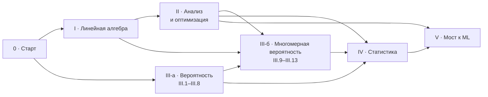

# Программа курса «Математика для машинного обучения»: хэндбук понятий

Это предисловие ко всему направлению. Машинное обучение — отдельные курсы: [`catalog.md`](catalog.md).

Программа v0.3. Она одновременно план курса и справочник: у каждого урока есть карточка с целями, основными понятиями (RU/EN), ключевыми формулами, типичными ошибками и практикой. Из этих карточек на этапе 1 генерируются страница «Программа», справочник понятий и шпаргалки к разделам CS229.

| Модуль | Файл | Уроков | Часов |
|---|---|---|---|
| 0. Старт | [`00-start.md`](00-start.md) | 9 | 8–10 |
| I. Линейная алгебра | [`01-linear-algebra.md`](01-linear-algebra.md) | 12 | 28–34 |
| II. Анализ и оптимизация | [`02-calculus.md`](02-calculus.md) | 10 | 22–26 |
| III. Вероятность | [`03-probability.md`](03-probability.md) | 13 | 26–30 |
| IV. Статистика | [`04-statistics.md`](04-statistics.md) | 8 | 18–22 |
| V. Мост к ML | [`05-bridge.md`](05-bridge.md) | 2 | 4–6 |
| **Итого** | | **54** | **≈ 106–128** |

Интерактивы, игры и лабораторные по модулям — [`interactives.md`](interactives.md).

Оценка часов — для основной персоны «знал, но забыл» и включает практику (не меньше 40% времени). Со школьного уровня — примерно в полтора раза больше. Порядок уроков и номера — в `content/courses/foundations/*/module.yaml`.

## Для кого и с чем приходить

**Персона — рефрешер** (решено): разработчик или аналитик, когда-то учивший вузовскую математику, хочет пройти CS229; 4–6 часов в неделю. Модуль 0 и простые темы проходятся тест-аутом.

**Входные знания:**

| Уровень | Что | Как проверяем |
|---|---|---|
| Обязательно | Школьная алгебра: степени, логарифмы, функции и графики; производная элементарных функций и правило цепочки | Адаптивная диагностика в уроке 0.2 |
| Обязательно | Python на уровне переменных, циклов и функций | Урок 0.8 учит минимуму NumPy |
| Не требуется | Вузовские ЛА, анализ, теорвер | Это содержание курса |

**Выходные критерии** — итоговая проверка с порогами, а не «прочитал». Ученик без справочников:

- выводит нормальные уравнения тремя способами и решает их в NumPy без `inv`;
- считает градиенты матричных выражений и проверяет их размерностями и конечными разностями;
- объясняет геометрию собственных векторов, квадратичных форм и SVD и применяет её к PCA;
- выводит MLE для Бернулли, гауссианы и многомерной гауссианы; связывает MAP с регуляризацией;
- проходит перенос на CS229: восстанавливает пропущенные шаги во фрагментах разделов «Linear regression», «Classification and logistic regression», «Generalized linear models», «Generative learning algorithms».

## Карта модулей

- **III-а (III.1–III.8)** не зависит от ЛА и анализа: одномерную выпуклость и неравенство Йенсена урок III.5 вводит сам. Его можно проходить параллельно с модулем I.
- **Матричное дифференцирование** (II.3) стоит после градиента и правила цепочки, а не в конце ЛА, как было в v0.1.
- **III-б** опирается на собственные векторы (I.9), квадратичные формы (I.10) и замену переменных (II.10).

## Сквозной кейс «Квартиры»

Синтетический набор с фиксированным seed: площадь, этаж, расстояние до метро, цена; бинарный признак «дороже медианы». Он проходит через весь курс:

| Модуль | Что делаем с данными |
|---|---|
| 0 | Проводим прямую «цена от площади» на глаз (урок-тизер 0.1) |
| I | Данные — матрица $X$; цена — проекция на пространство столбцов (капстоун I.12) |
| II | Минимизируем функцию потерь градиентным спуском и методом Ньютона |
| III | Шум в цене, распределение признаков, ковариация признаков |
| IV | Оценки параметров, MLE, MAP, кросс-валидация |
| V | Линейная регрессия тремя способами; дальше — курсы ML: регрессия и классификация («Основы»), GDA («Классические методы»), PCA («Без учителя») |

## Как читать карточку урока

- **Время** — оценка для основной персоны, с практикой.
- **Опирается на** — уроки-пререквизиты; на сайте это строка «Опирается на» с галочками «знаю»; ученик может отметить урок прямо там.
- **CS229** — раздел конспекта `main-notes-2026-spring` по названию.
- **Цели** — измеримые глаголы («вычислить», «вывести», «объяснить геометрически»); каждая проверяется хотя бы одним заданием.
- **Основные понятия** — термин, английский эквивалент, определение в одну строку.
- **Формулы** — ключевые; с выводом — в реестре `content/formulas`.
- **Типичные ошибки** — то, что станет неверными вариантами ответов и блоками «Типичная ошибка».
- **Практика** — виджет, игра, лабораторная, упражнения.
- ★ — углубление: не блокирует прогресс.

## Покрытие CS229

Какие уроки математики нужны каждому разделу конспекта. Сами модели разбираются в курсах ML (`catalog.md`, «Покрытие CS229»).

| Раздел конспекта CS229 | Что из курса нужно |
|---|---|
| Linear regression (LMS, normal equations, probabilistic interpretation, locally weighted regression) | I.3–I.8, II.1–II.6, III.7, IV.3, V.1 |
| Classification and logistic regression (Newton's method, multi-class) | 0.5, II.5, II.7, III.6, IV.3, III.13 |
| Generalized linear models | IV.5 |
| Generative learning algorithms (GDA, Naive Bayes, Laplace smoothing) | III.2, III.11, IV.3, IV.4, IV.6 |
| Kernel methods | I.2, I.10 (матрица Грама), III.1★ (число мономов) |
| Support vector machines | I.8 (гиперплоскость), II.8, II.9★ |
| Deep learning (backpropagation, vectorization) | 0.8, I.3 (адамарово произведение), II.2, II.3 |
| Generalization (bias-variance, double descent) | IV.2, IV.7, I.11 (псевдообратная), III.8 (union bound, ★ Хёффдинг) |
| Regularization and model selection | IV.6, IV.7 |
| Clustering and k-means | II.6 (покоординатный спуск) |
| The EM algorithm | III.5 (Йенсен), III.12, III.13, II.8 |
| Principal components analysis | I.9–I.11, II.8, III.10 |
| Independent components analysis | II.10, III.10, I.7 |
| Reinforcement learning (основы) | 0.4 (геометрический ряд), III.9 (условное матожидание); ★ цепи Маркова — кандидат на курс ML |

## Что изменилось в v0.3

- Машинное обучение выделено в отдельные курсы (`catalog.md`). Модуль V сокращён до двух уроков: V.1 «Линейная регрессия тремя способами» и V.2 «Итоговая проверка: математика в выводах ML». Уроки V.2–V.9 v0.2 (логистическая регрессия, GLM, GDA и наивный Байес, ядра и SVM, обратное распространение, смещение и разброс, k-means и EM, PCA) переехали в курсы ML; старые адреса — в `content/redirects.yaml`.
- Итого: 54 урока (52 обязательных), ≈ 106–128 часов.

## Что изменилось после ревью v0.1

По трём профессиональным ревью (методика, математика, EdTech) и дизайн-критике:

- **Добавлено:** интеграл (0.7), минимум NumPy (0.8), соглашения об обозначениях (0.9); SGD и метод Ньютона (II.6, II.7); множители Лагранжа обязательны (II.8), KKT — углубление (II.9); кратные интегралы и замена переменных (II.10); индикатор, i.i.d., замена переменной в плотности, Монте-Карло, union bound (III.4, III.8); смеси и скрытые переменные (III.12); экспоненциальное семейство обязательно (IV.5); риск и кросс-валидация (IV.7); капстоуны по главам CS229 до PCA (V.3–V.9).
- **Перенесено:** матричное дифференцирование из I.12 в II.3 (после градиента).
- **Сжато:** доверительные интервалы и проверка гипотез — один урок-углубление (IV.8).
- **Исправлено в математике:** $\nabla_A \log\lvert\det A\rvert = A^{-\top}$ (с модулем); линии уровня квадратичной формы — эллипсы только при $A \succ 0$; PSD — только для симметричных; условие нормальных уравнений учитывает свободный член; разложение ошибки предсказания трёхчленное ($\sigma^2$ + смещение² + разброс); сглаживание Лапласа — среднее апостериорного при Beta(1, 1).
- **Часы:** 65–85 → 122–148 (реалистичная оценка с практикой).
