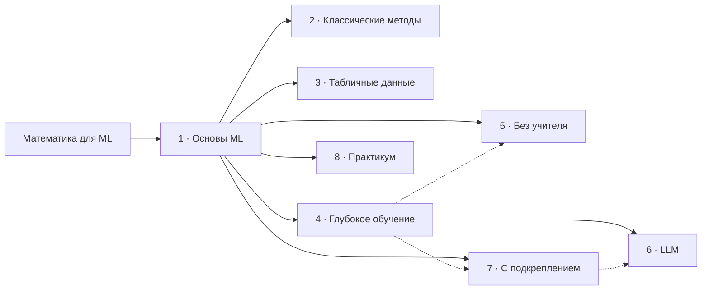

# Каталог курсов

Машинное обучение — слишком большая тема для одного курса: объём CS229 и практики — около 200–270 часов. Поэтому направление разбито на восемь курсов по 20–45 часов. Каждый даёт законченный результат и проект для портфолио. «Математика для машинного обучения» — предисловие ко всему направлению.

| Курс | ID | Уроков | Часов | Проект | Нужно до начала |
|---|---|---|---|---|---|
| **Математика для машинного обучения** | `foundations` | 54 (52 обязательных) | 106–128 | лабораторные | школьная алгебра, Python |
| **1. Основы машинного обучения** | `ml-basics` | 11 | 38–46 | P1 «Цена квартиры», P2 «Отклик на предложение банка» | математика |
| **2. Классические методы: генеративные модели, ядра и SVM** | `ml-classic` | 8 (1★) | 25–32 | P3 «Фильтр сообщений» | основы ML |
| **3. ML на табличных данных** | `ml-tabular` | 9 | 28–35 | P4 «Кредитный скоринг» | основы ML |
| **4. Глубокое обучение** | `deep-learning` | 9 | 30–37 | P5 «Цифры с нуля» | основы ML |
| **5. Обучение без учителя и представления** | `unsupervised` | 7 (2★) | 21–27 | P6 «Сегменты клиентов» | основы ML |
| **6. Языковые модели и LLM** | `llm` | 7 (1★) | 23–29 | P7 «Умный поиск по курсу» | глубокое обучение |
| **7. Обучение с подкреплением** | `rl` | 6 (1★) | 19–25 | P8 «Агент» | основы ML |
| **8. Практикум: свой ML-проект** | `ml-project` | 3 | 20–40 | P9 — своя задача | основы ML и ещё один курс |
| **Итого ML** | | **60 (55 обязательных)** | **≈ 204–271** | **9 проектов** | |

Порядок модулей и уроков, номера и слаги — в `content/courses/<ID>/`. Программа каждого курса — `docs/program/<ID>/README.md`; программа курса математики — [`README.md`](README.md).

## Почему так

- **Один курс — один результат.** После «Основ» ученик строит и честно оценивает линейные модели. После «Табличных данных» — делает модель кредитного скоринга так, как её делают на работе. После «Глубокого обучения» — обучает сети в PyTorch. Короткий курс проще закончить: доходимость падает с длиной.
- **Общая база — один раз.** Задача обучения, линейные модели, метрики, смещение и разброс, регуляризация и кросс-валидация нужны всем остальным курсам. Они собраны в «Основах», остальные курсы на них опираются и не повторяют.
- **Курсы после «Основ» независимы.** Табличные данные, глубокое обучение, обучение без учителя, RL и классические методы можно проходить в любом порядке. Исключение — LLM: они требуют глубокого обучения.
- **Теория и практика разведены, но связаны.** «Классические методы» добирают теорию CS229 (генеративные модели, SVM, сложность выборки). «Табличные данные» — инженерную практику, которой в конспекте нет. Тот, кому нужен полный CS229, проходит оба.
- **Проект в каждом курсе.** Итоговый практикум — свой проект от постановки до защиты, как проект в CS229.

## Граф и маршруты



Сплошная стрелка — обязательно до начала курса, пунктир — рекомендуется: самообучение в «Без учителя» и градиент стратегии с сетью в RL проще после глубокого обучения; выравнивание по предпочтениям (урок ★ в LLM) — после RL. «Опирается на» в карточках уроков точнее графа: курс можно начать, освежив только нужные уроки.

**Маршруты** (подсказка на главной, не ограничение):

| Цель | Курсы |
|---|---|
| Пройти CS229 целиком | Математика → Основы → Классические методы → Глубокое обучение → Без учителя → LLM → RL |
| ML-инженер в продукте с табличными данными | Математика → Основы → Табличные данные → Практикум |
| Нейросети и LLM | Математика → Основы → Глубокое обучение → LLM → Практикум |

## Покрытие CS229

Разделы конспекта `main-notes-2026-spring` по названию. Номера глав не используем (см. `docs/conventions/sources.md`).

| Раздел конспекта CS229 | Курс и уроки |
|---|---|
| Linear regression (LMS, normal equations, probabilistic interpretation, locally weighted linear regression) | Основы 1.2–1.3; вывод нормальных уравнений — математика V.1 |
| Classification and logistic regression (perceptron, Newton's method, multi-class) | Основы 1.4–1.5 |
| Generalized linear models | Основы 1.6 |
| Generative learning algorithms (GDA, Naive Bayes, Laplace smoothing, event models for text) | Классические 1.1–1.2 |
| Kernel methods; Support vector machines | Классические 2.1–2.4 |
| Deep learning (neural networks, backpropagation, vectorization, modules of modern networks) | Глубокое обучение 1.1–3.2 |
| Generalization (bias-variance, double descent, sample complexity) | Основы 2.2; глубокое обучение 2.2; классические 3.1 |
| Regularization and model selection (implicit regularization, cross validation, Bayesian statistics) | Основы 2.3–2.4; глубокое обучение 2.2; классические 3.2 |
| Clustering and the k-means algorithm; EM algorithms (incl. VAE) | Без учителя 1.1–1.4★ |
| Principal components analysis; Independent components analysis | Без учителя 2.1–2.2★ |
| Self-supervised learning and foundation models; representation learning | Без учителя 2.3; глубокое обучение 3.3; LLM 1.4 |
| Large language models | LLM 1.1–2.3 |
| Reinforcement learning; LQR, DDP and LQG; Policy gradient (REINFORCE) | RL 1.1–1.4★, 2.2 |
| Лекции, не главы конспекта: decision trees, boosting, ML advice | Табличные данные 2.1–2.4; основы 2.5 |
| Нет в конспекте, но нужно в работе: валидация по группам и времени, признаки, интерпретация, Q-обучение, RAG | Табличные данные 1.1–3.2; RL 2.1; LLM 2.3 |

## Как устроены курсы ML

Урок — как в курсе математики (`docs/conventions/pedagogy.md`): 2–4 цикла по 7–12 минут, не больше 5 минут чтения без вопроса, проверки с разбором неверных вариантов, галочка «знаю». Для ML добавляются три правила:

1. **Алгоритм дважды:** сначала с нуля на NumPy (10–40 строк), потом библиотека (scikit-learn, PyTorch, CatBoost) и сравнение результатов.
2. **Эксперимент с предсказанием:** перед запуском ученик предсказывает исход («что будет с ошибкой на тесте, если увеличить степень полинома?»), потом запускает и сверяет.
3. **Проект на реальных данных** с автопроверкой этапов и отчётом в конце курса.

**Где выполняется код:**
- ячейки в уроке — Pyodide в браузере: NumPy и scikit-learn, наборы до 10⁴ объектов, обучение до 10 секунд;
- лабораторные и проекты — Colab (основное; бесплатный GPU — для глубокого обучения и LLM) и локально. PyTorch и LLM — только там.

**Ссылки между курсами.** В карточке: «Опирается на: математика — II.3, IV.3; основы ML — 1.4». На сайте у каждого пререквизита — чекбокс «знаю», общий для всех курсов. Ключ урока в данных и прогрессе — `<курс>/<модуль>/<slug>`, например `ml-basics/linear-models/logistic-regression`. Номера в URL и ID не попадают.

## Данные

Лицензию каждого набора подтвердить при реализации курса и записать в ADR. Пока лицензия не подтверждена, набор не публикуем.

| Набор | Курсы | Источник и лицензия |
|---|---|---|
| «Квартиры» | основы, табличные | Наш синтетический (из курса математики), seed |
| California Housing | P1 | scikit-learn `fetch_california_housing` (StatLib) — [проверить лицензию] |
| Bank Marketing | P2 | UCI, CC BY 4.0 |
| SMS Spam Collection; «Отзывы» | классические, P3 | UCI, CC BY 4.0; «Отзывы» — наш синтетический корпус на русском |
| Default of Credit Card Clients | табличные, P4 | UCI, CC BY 4.0 |
| Цифры 8×8; MNIST | глубокое обучение, P5 | UCI Optical Recognition of Handwritten Digits (CC BY 4.0); MNIST (CC BY-SA 3.0) |
| Online Retail | без учителя, P6 | UCI, CC BY 4.0 |
| Тексты нашего курса | LLM, P7 | Наши: глоссарий и уроки |
| Сеточный мир; CartPole | RL, P8 | Наш; Gymnasium (MIT) |

Предобученные модели (глубокое обучение 3.3, LLM) — небольшие открытые с лицензией Apache 2.0 или MIT; выбор и лицензия — в ADR при реализации.

## Порядок разработки

1. **Математика** — этапы 1–5 плана (`docs/implementation/PLAN.md`).
2. **Основы ML** — первый курс ML: база для всех остальных. Полные карточки уроков уже есть.
3. **Табличные данные** и **глубокое обучение** — самые востребованные; «Практикум» — вместе с табличными данными.
4. **LLM**, **без учителя**, **RL**, **классические методы** — по спросу после пилота.

Для курсов 2–8 сейчас есть программа курса: уроки с идеей в одну строку, интерактивы, проект. Полные карточки уроков пишутся первой задачей этапа курса в плане.

## Карточка урока ML

Формат — как в курсе математики, с тремя добавками: «Идея урока», «Зачем на практике» и «Практика» по видам.

```markdown
### 1.4. Логистическая регрессия и метод Ньютона

**Время:** 3 ч. **Опирается на:** математика — 0.5, II.5, II.7, IV.3; основы ML — 1.2. **CS229:** «Classification and logistic regression».

**Идея урока.** Одна-три фразы простыми словами: что делает метод и почему он так устроен.

**Цели.** Ученик:
- измеримые глаголы: выводит, реализует, объясняет, выбирает, диагностирует.

**Основные понятия**

| Понятие | English | Коротко |
|---|---|---|

**Формулы:** ключевые; с выводом — в реестре `content/formulas` (ID `f.…`).

**Типичные ошибки:** то, что станет неверными вариантами ответов и блоками «Типичная ошибка».

**Практика:**
- **Виджет** «…»: что ученик двигает, что видит, к какому выводу приходит.
- **Игра** «…» (если есть): действие, метрика очков, граничный случай в последних уровнях.
- **Python:** ячейка в браузере или лабораторная — что пишется с нуля, с чем сравнивается.
- **Проверки:** 2–3 вопроса «предскажи, потом проверь»; неверные варианты — из типичных ошибок.

**Зачем на практике:** где это используют в работе.
```

★ — углубление: не блокирует прогресс и не входит в счётчики.

## Чего в каталоге нет

- Продакшен-MLOps (оркестрация, мониторинг, деплой) — обзор в «Табличных данных» 3.2 и «Практикуме», без инфраструктуры.
- Компьютерное зрение, речь, рекомендательные системы как отдельные курсы — кандидаты после пилота; сейчас — темы проектов.
- Обучение больших моделей с нуля: в LLM — небольшие открытые модели и адаптация.
